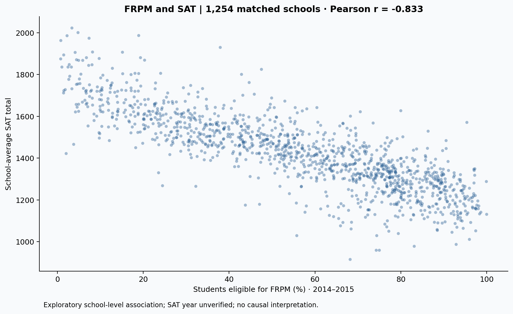

# California Schools: SAT Performance, FRPM Eligibility & Opening Trends

**A reproducible SQL + Python analysis of a historical California schools snapshot.**

Author: Dilsher Singh  
Tools: SQLite · SQL joins, CTEs and window functions · Python · pandas · Matplotlib



## Questions and methods

| Question | SQL technique | Output |
|---|---|---|
| Which counties have the highest school-average SAT totals? | JOIN, GROUP BY, weighted aggregation | All-county CSV; top-ten chart with school counts |
| How do recorded school openings vary by year? | strftime, GROUP BY | Annual series and line chart |
| How are schools distributed across FRPM eligibility bands? | CTE, CASE, aggregation | Counts and corrected mean eligibility percentages |
| Which schools have the highest reported SAT totals? | CTE, RANK window function | Ranking with ties and test-taker counts |
| How does FRPM eligibility relate to SAT totals? | Normalized composite-key join | School-level CSV, scatter plot and correlation |

## Main findings

- Marin has the highest unweighted county mean: **1,619.78**, based on nine scored schools. County comparisons need sample sizes; Mariposa has one scored school while Santa Clara has 47.
- Mission San Jose High has the highest observed SAT total: **2,023**.
- **4,238** records fall in the analyst-defined highest FRPM band (>75% eligible); the mean eligibility share in this band is **87.67%**, correcting the original notebook's zero-valued average.
- The FRPM–SAT join includes **1,254 schools** and has Pearson **r = −0.833**. This is an exploratory association, not evidence of causation; the SAT reporting year is unverified.

Read [the generated findings and charts](outputs/FINDINGS.md) and [data-quality counts](outputs/data_quality.json).

## Run locally

Python 3.11 or newer recommended. The supplied outputs were generated with Python and the pinned versions in `requirements.txt`.

```bash
python -m venv .venv
```

Windows PowerShell:

```powershell
.venv\Scripts\Activate.ps1
```

macOS/Linux:

```bash
source .venv/bin/activate
```

Then, from this folder:

```bash
python -m pip install -r requirements.txt
python main.py
python -m unittest discover -s tests -v
```

No account, network download, or database server is needed after installing dependencies. Paths resolve from the project location, not a personal Downloads folder. Optional paths: `python main.py --db PATH --output PATH`.

## Project structure

- `main.py`: command-line entry point.
- `sql/`: five actual-schema queries; no invented intermediate tables.
- `src/analysis.py`: read-only querying, charts, exports and generated report.
- `data/schools_analysis.sqlite`: analysis-only column subset of the supplied source, with all source rows retained.
- `data/provenance.json`: source SHA-256, column list and row counts.
- `prepare_data.py`: regenerate that subset from the original `cdeschools.sqlite`.
- `outputs/`: five CSVs, five PNGs, a findings report and quality metrics.
- `tests/test_analysis.py`: independent pandas checks against SQL outputs.
- `PORTFOLIO_COPY.md`: suggested GitHub and Upwork descriptions.

To rebuild the analysis database from your original file:

```bash
python prepare_data.py /path/to/cdeschools.sqlite
python main.py
```

The subset omits unrelated addresses, staff names, emails and phone numbers. School identifiers stay as text to preserve leading zeros. All database access during analysis is read-only.

## Data definitions and limitations

**Historical source:** the user-supplied `cdeschools.sqlite`, with tables `schools`, `satscores` and `frpm`. The original course materials point to the Stanford Computational Journalism [SQLite starterpacks](https://2016.padjo.org/tutorials/sqlite-data-starterpacks/). That page could not be retrieved during this review; exact SAT vintage and redistribution terms were not independently confirmed. Check the source terms before putting the database in a public repository. Code, documentation and generated charts can be reviewed independently of publishing the data.

**FRPM:** the table identifies academic year 2014–2015. Two records have no year; 189 have no eligibility share. Missing-year and missing-share groups may overlap. Requiring the stated academic year changes the High band from 2,416 in the original notebook to 2,415; one otherwise eligible record has no year. FRPM eligibility is used as a socioeconomic proxy, not a direct household-income measure. Bands are Low [0,25%], Moderate (25%,50%], High (50%,75%], Very High (75%,100%].

**SAT:** only school-level records (`rtype = 'S'`) with positive test-taker counts and all three component averages between 200 and 800 are used. The displayed total is the sum of reported reading, math and writing averages, on a 600–2400 scale. It is not a current two-component score. No imputation is applied to missing scores.

**Population differences:** 1,254 schools match FRPM and valid SAT rows, while 1,251 valid SAT schools match the directory for county analysis. These analyses use different join populations; do not assume their denominators are identical. The pipeline rejects duplicate school IDs in the FRPM–SAT join.

**County means:** the primary measure weights each scored school equally. `weighted_sat` weights rounded school-average totals by test-taker counts and therefore approximates a test-taker-level mean. Small samples and participation differences limit ranking comparisons.

**Opening-date anomaly:** 10,679 named records share `1980-07-01`. This concentration may be administrative, but that explanation is unverified. The chart retains these rows and flags the anomaly, using a symmetric-log vertical scale. It must not be described as a demonstrated school-construction boom.

**Opening dates:** yearly counts include named school records across status types, including closed and pending records. They describe opening dates retained in the snapshot, not net additions, current operating schools, or a complete history. The source contains dates through 2017; these are not current statistics.

**Interpretation:** no causal claims, predictive accuracy claims, or claims about current school quality. Temporal alignment between SAT and FRPM cannot be verified from the supplied tables. A negative correlation does not show that poverty alone explains scores.

## Verification

The tests compare SQL aggregates against independent pandas calculations, verify opening-year counts, check join keys and ranges, and confirm key source results. Successful execution generates all charts and CSVs without manual intermediate steps.

## Further work

Verify the SAT year and source terms; add participation-aware comparisons and school-type controls; build an interactive dashboard only after those definitions are settled.
