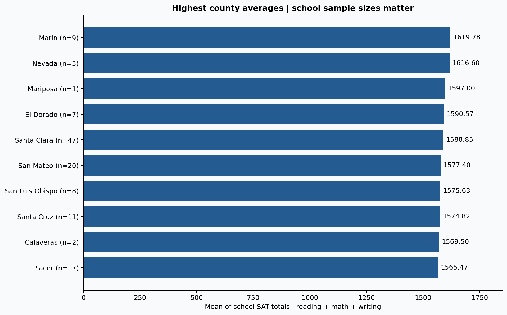
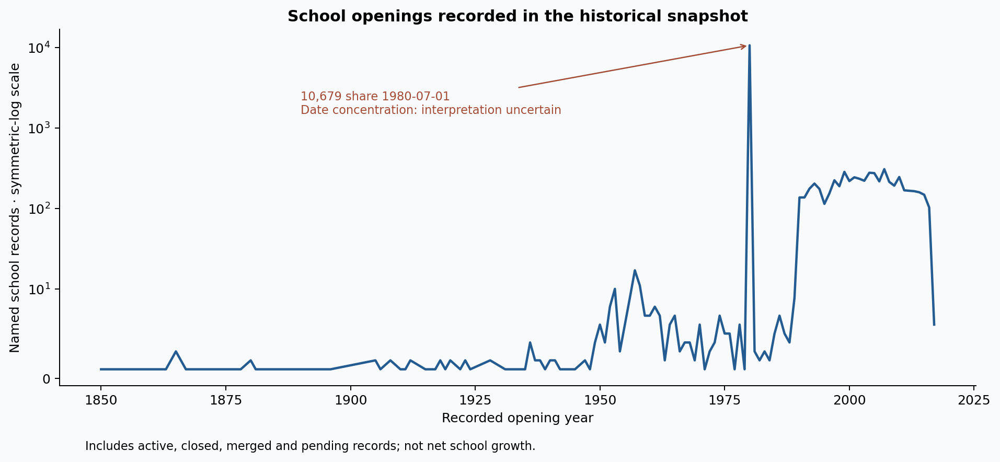
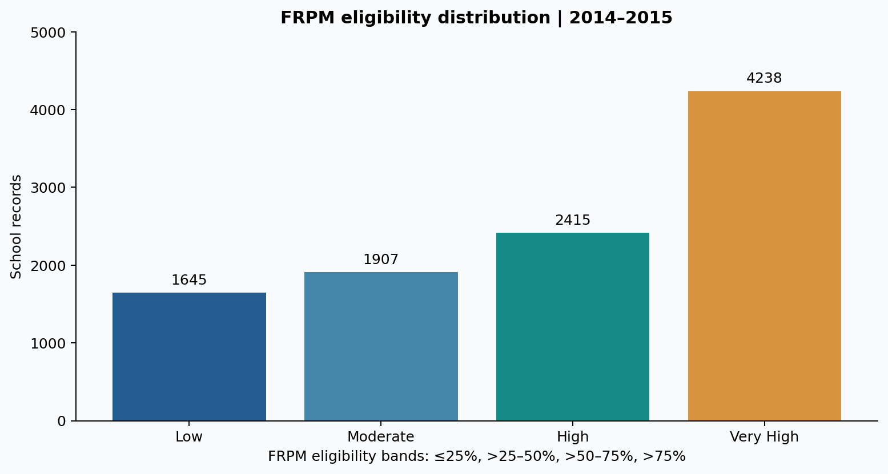
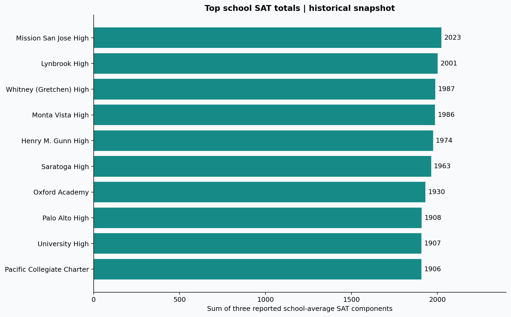
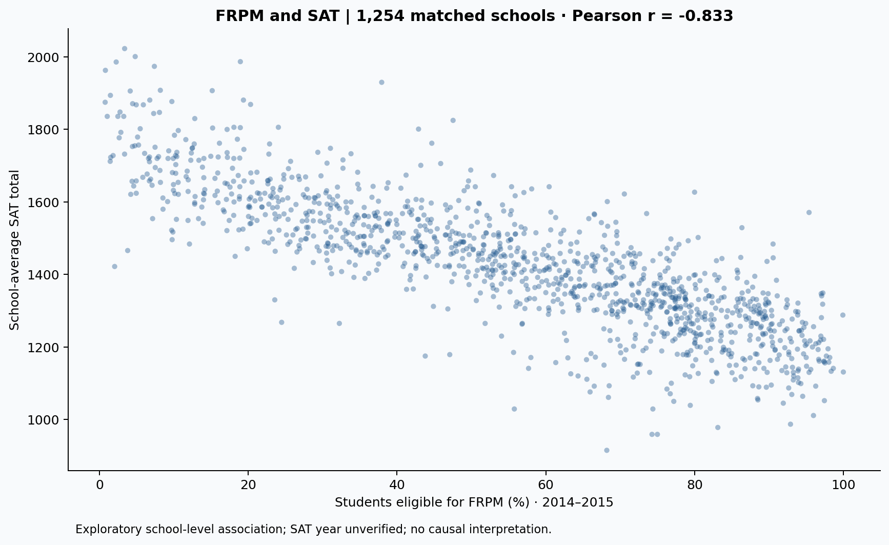

# California Schools — findings and limitations

Generated from the bundled analysis database by `python main.py`.

## Verified findings

- Marin leads the school-weighted county means at 1,619.78, based on 9 scored schools.
- Mission San Jose High has the highest observed three-component SAT total: 2,023.
- The FRPM analysis includes 10,205 records with a valid share and the 2014–2015 year.
- The highest recorded annual opening count is 10,681 in 1980. This is a snapshot-based count, not a measure of net growth.
- The exploratory school-level FRPM/SAT join contains 1,254 schools; Pearson correlation is -0.833.

| FRPM category | School records | Mean eligibility |
|---|---:|---:|
| Low | 1,645 | 13.28% |
| Moderate | 1,907 | 37.98% |
| High | 2,415 | 63.51% |
| Very High | 4,238 | 87.67% |

## Interpretation

Opening-date anomaly: 10,679 named school records share 1980-07-01. This may reflect an administrative or default date, but its meaning is not verified. Preserve the records and do not interpret the spike as demonstrated construction activity. The time chart uses a symmetric-log vertical scale to keep smaller counts visible.

The matched sample shows how FRPM eligibility and reported school SAT averages vary together. It does not establish a causal effect of household income, school funding, or county. SAT participation, admissions, school type, and other factors may affect comparisons. The SAT year is not encoded in the supplied table, so temporal alignment with FRPM is unverified.

## Data quality and scope

- Source tables: 17,686 school-directory records, 2,331 SAT records and 10,395 FRPM records.
- SAT records include state, county and district aggregates. Queries retain school rows only (`rtype = S`); 1,251 schools pass score and test-taker filters and match the directory.
- FRPM has 189 missing eligibility shares and 2 missing years. These exclusions can overlap; do not add them.
- The directory contains 1,369 unnamed records. Opening trends exclude these and 0 named records without a parseable opening date.
- County means weight schools equally. A second CSV column weights the rounded school averages by test-taker counts; it is an approximation of a student-level mean.
- FRPM bands are analyst-defined eligibility categories, not official poverty classifications.
- Rankings include all valid scored schools, with sample sizes disclosed. They are not comprehensive measures of school quality.
- Dates describe a historical snapshot. No results represent current school performance.

## Charts

