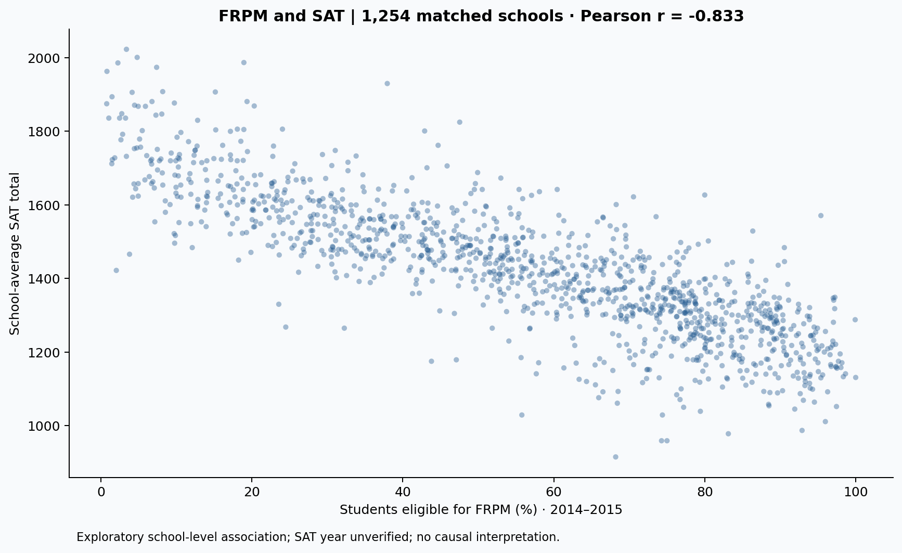

# California Schools Analysis

**SQL + Python portfolio project by Dilsher Singh**

Explore how reported SAT performance, free/reduced-price meal (FRPM) eligibility, and recorded school openings vary in a historical California schools snapshot.

**Tools:** Python · pandas · SQLite · SQL joins, CTEs and window functions · Matplotlib



## Selected findings

- **1,254 matched schools:** FRPM eligibility and SAT totals have Pearson **r = −0.833**. This is an exploratory school-level association, not a causal result.
- **Marin: 1,619.78** — the highest unweighted county mean, based on **nine scored schools**. Sample size and test participation matter when comparing counties.
- **4,238 records** fall in the >75% FRPM eligibility band; their mean eligibility share is **87.67%**.

## Work demonstrated

- Normalize school identifiers and join tables while preserving leading zeros.
- Filter incomplete or invalid SAT scores, check duplicate keys, and document missing values.
- Use SQL aggregation and window functions to generate five analyses, CSV exports, and charts.
- Compare SQL results with independent pandas calculations in automated tests.

## Run the project

From the repository root, using Python 3.11 or newer and preferably a virtual environment:

```bash
cd California_Schools_Portfolio
python -m pip install -r requirements.txt
python main.py
python -m unittest discover -s tests -v
```

## Interpretation and limitations

These are **historical, not current school statistics**. FRPM identifies 2014–2015, but the SAT reporting year is unverified. SAT totals use the older **600–2400 scale**. School-level correlation does not establish causation or individual student outcomes. County comparisons use different sample sizes.

The source contains an unusual concentration of opening dates on 1980-07-01; this is not evidence of a construction boom. Source redistribution terms remain unverified; see the full documentation.

## Explore the evidence

- [Full methodology, definitions and setup](California_Schools_Portfolio/README.md)
- [Generated findings](California_Schools_Portfolio/outputs/FINDINGS.md)
- [Charts and CSV results](California_Schools_Portfolio/outputs/)
- [SQL queries](California_Schools_Portfolio/sql/) · [Python source](California_Schools_Portfolio/src/)
- [Validation notes](California_Schools_Portfolio/VALIDATION.md) · [Tests](California_Schools_Portfolio/tests/)
